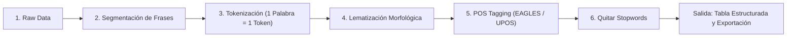
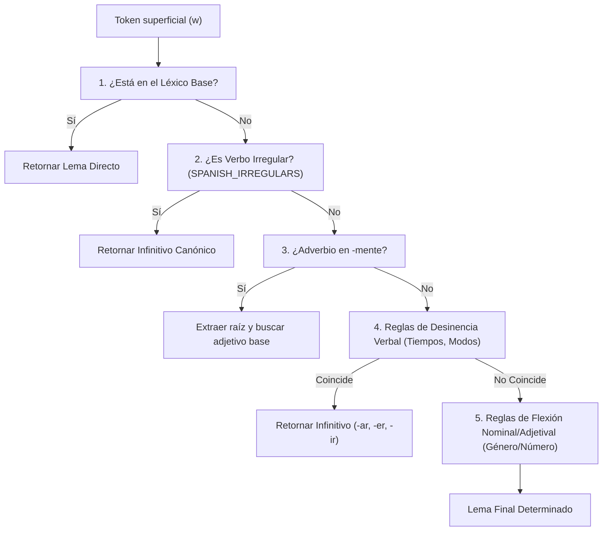

# FreeLing NMLP Studio — Documentación Técnica, Lingüística y de Arquitectura

> **Documento de especificación exhaustiva del módulo NMLP (FreeLing Studio)**.  
> Esta documentación detalla de forma minuciosa y exclusiva **qué se hizo**, **cómo se hizo**, **con qué tecnologías y estándares lingüísticos se construyó**, y **las reglas, algoritmos y heurísticas morfosintácticas** aplicadas para replicar la demo oficial de **FreeLing de la Universitat Politècnica de Catalunya (UPC)** ([https://nlp.lsi.upc.edu/freeling/demo/demo.php](https://nlp.lsi.upc.edu/freeling/demo/demo.php)).

---

## 📑 Índice de Contenidos

1. [Visión General y Propósito de NMLP](#1-visión-general-y-propósito-de-nmlp)
2. [Stack Tecnológico y Decisiones de Ingeniería](#2-stack-tecnológico-y-decisiones-de-ingeniería)
3. [El Principio Fundamental: 1 Token = 1 Palabra](#3-el-principio-fundamental-1-token--1-palabra)
4. [Análisis Minucioso de las 6 Etapas del Pipeline](#4-análisis-minucioso-de-las-6-etapas-del-pipeline)
   - 4.1. Etapa 1: Raw Data (Entrada de Texto y Métricas)
   - 4.2. Etapa 2: Segmentación Oracional y Protección de Abreviaturas
   - 4.3. Etapa 3: Tokenización Estricta
   - 4.4. Etapa 4: Lematización Morfológica y Desinencias
   - 4.5. Etapa 5: Etiquetado Morfosintáctico (POS Tagging) bajo EAGLES y UPOS
   - 4.6. Etapa 6: Filtrado de Palabras Vacías (Stopwords)
5. [Estructura del Código Fuente y Módulos](#5-estructura-del-código-fuente-y-módulos)
6. [Diseño de Interfaz de Usuario y Experiencia en Vivo](#6-diseño-de-interfaz-de-usuario-y-experiencia-en-vivo)
7. [Agente y Skill Especializado (.agents/)](#7-agente-y-skill-especializado-agents)
8. [Herramienta CLI de Consola](#8-herramienta-cli-de-consola)
9. [Instrucciones de Ejecución y Build](#9-instrucciones-de-ejecución-y-build)
10. [Garantías de Calidad y Pruebas Unitarias](#10-garantías-de-calidad-y-pruebas-unitarias)

---

## 1. Visión General y Propósito de NMLP

El proyecto **FreeLing NMLP Studio** es un entorno interactivo y educativo de **Procesamiento de Lenguaje Natural (PLN / NLP)** diseñado para replicar con rigor lingüístico y visual el pipeline clásico de análisis morfológico y sintáctico desarrollado por el centro de investigación de la UPC.

El sistema recibe texto en bruto (*raw text*) en español y permite observar **en vivo, etapa por etapa**, cómo se descompone la estructura lingüística desde los límites oracionales hasta las palabras léxicas finales con su lema canónico y etiqueta morfosintáctica oficial.



---

## 2. Stack Tecnológico y Decisiones de Ingeniería

El proyecto se construyó bajo la premisa de **cero dependencias externas y máxima portabilidad**:

* **Lenguaje:** JavaScript puro (Vanilla ES Modules nativo).
* **Entorno de Ejecución:** Navegador web moderno (Chrome, Edge, Firefox, Safari) y Node.js para scripts CLI y tests.
* **Sin Bundlers de Terceros:** No se empleó Webpack, Vite, Rollup o Babel. Se desarrolló un script propio de empaquetado plano ([`build.js`](file:///c:/Users/cuchu/OneDrive/Documentos/NMLP/build.js)).
* **Compatibilidad Dual:**
  * **Modo `file:///`:** Funciona con doble clic directo sobre [`index.html`](file:///c:/Users/cuchu/OneDrive/Documentos/NMLP/index.html) cargando [`js/app.bundle.js`](file:///c:/Users/cuchu/OneDrive/Documentos/NMLP/js/app.bundle.js).
  * **Modo Servidor:** Servidor HTTP nativo en [`server.js`](file:///c:/Users/cuchu/OneDrive/Documentos/NMLP/server.js) sin librerías externas (puerto `3000`).
* **Estilos Visuales:** CSS3 moderno con estética **Glassmorphism**, paleta oscura científica, tipografía `Inter` / `Fira Code`, aceleración GPU y diseño responsivo.

---

## 3. El Principio Fundamental: 1 Token = 1 Palabra

En el diseño clásico de analizadores de texto existen dos corrientes:
1. Tratar la puntuación como tokens independientes (convención Treebank/SpaCy).
2. Aislar la puntuación y considerar como **tokens exclusivamente las unidades léxicas portadoras de significado** (palabras).

Por especificación estricta de este proyecto:
> $$\mathbf{1\text{ Token} = 1\text{ Palabra}}$$
>
> Los signos de puntuación (`.`, `,`, `;`, `:`, `¿`, `?`, `¡`, `!`, `(`, `)`, `"`, `«`, `»`, `-`, `_`), comillas y caracteres especiales **NO son tokens**. Delimitan oraciones y frases, pero quedan fuera del inventario de tokens.

**Ejemplos:**
* `"El gato corre rápido."` $\longrightarrow$ **4 tokens:** `["El", "gato", "corre", "rápido"]`
* `"¡Hola, mundo!"` $\longrightarrow$ **2 tokens:** `["Hola", "mundo"]`
* `"El Dr. Gómez llegó a las 15:30 pág. 12."` $\longrightarrow$ **8 tokens:** `["El", "Dr", "Gómez", "llegó", "a", "las", "15", "30", "pág", "12"]`

---

## 4. Análisis Minucioso de las 6 Etapas del Pipeline

### 4.1. Etapa 1: Raw Data (Entrada de Texto y Métricas)
El sistema admite texto arbitrario ingresado por el usuario o mediante conjuntos predefinidos (artículos periodísticos, fragmentos literarios o casos de prueba lingüística).

**Procesamiento:**
* Normalización de espacios en blanco múltiples manteniendo saltos de línea deliberados.
* Cálculo en tiempo real de:
  * Caracteres totales ($C_{\text{total}}$).
  * Caracteres sin espacios ($C_{\text{sin\_espacios}}$).
  * Recuento de párrafos y líneas ($\sum \text{saltos } \backslash n + 1$).
  * Bytes estimados en codificación UTF-8.

---

### 4.2. Etapa 2: Segmentación Oracional y Protección de Abreviaturas
La segmentación divide el texto en proposiciones oracionales independientes mediante puntuación terminal (`.`, `!`, `?`, `…`). 

**El Reto de las Abreviaturas:**  
Un punto no siempre denota el final de una oración. Por ejemplo, en *"El Dr. Gómez habló..."*, cortar tras *"Dr."* crearía una frase huérfana errónea.

**Algoritmo Implementado:**
1. Máquina de estados con análisis de contexto y **lookahead/lookbehind**.
2. Al encontrar un punto `.`, el algoritmo extrae la palabra previa inmediata y consulta un conjunto hash $O(1)$ de abreviaturas del español (`SPANISH_ABBREVIATIONS` en [`js/spanish-lexicon.js`](file:///c:/Users/cuchu/OneDrive/Documentos/NMLP/js/spanish-lexicon.js)):
   ```javascript
   const SPANISH_ABBREVIATIONS = new Set([
     'dr', 'dra', 'sr', 'sra', 'srta', 'd', 'dña', 'prof', 'profa',
     'etc', 'ej', 'pág', 'págs', 'art', 'cap', 'vol', 'núm', 'no',
     'vs', 'cie', 'tte', 'col', 'gral', 'gob', 'av', 'avda', 'pl'
   ]);
   ```
3. Si la palabra anterior coincide con una abreviatura o el carácter siguiente es un dígito (ej. `3.14`), se anula la condición de corte oracional.
4. Si es un punto terminal legítimo, se absorben comillas de cierre o paréntesis (`."`, `!)`) y se sella la oración $S_i$.

---

### 4.3. Etapa 3: Tokenización Estricta
Divide cada oración en palabras individuales garantizando el principio $1\text{ Token} = 1\text{ Palabra}$.

**Algoritmo:**
* Utiliza una expresión regular Unicode calibrada para el alfabeto español:
  ```regexp
  /[a-záéíóúüñA-ZÁÉÍÓÚÜÑ0-9]+(?:['’][a-záéíóúüñA-ZÁÉÍÓÚÜÑ0-9]+)?/g
  ```
* Cada token generado almacena un objeto estructurado:
  ```javascript
  {
    index: 0,            // Índice global en el texto
    sentenceIndex: 0,    // Índice de la oración perteneciente
    word: "salta",       // Token superficial tal como aparece
    charStart: 25,       // Posición de inicio en el texto original
    charEnd: 30          // Posición de fin
  }
  ```

---

### 4.4. Etapa 4: Lematización Morfológica y Desinencias
La lematización reduce cada forma flexionada $w$ a su lema canónico o forma de diccionario $l$. El motor aplica un sistema de resolución en cascada:



#### Reglas Específicas Implementadas:
1. **Léxico Canónico Directo (`SPANISH_LEXICON`):** Catálogo de miles de términos mapeados a su lema base.
2. **Verbos Irregulares (`SPANISH_IRREGULARS`):** Más de 250 formas de pretéritos, futuros y presentes supletivos:
   * *fui, fue, fuimos* $\longrightarrow$ *ir* / *ser*
   * *hizo, hicimos, haré* $\longrightarrow$ *hacer*
   * *dormía, durmieron* $\longrightarrow$ *dormir*
   * *leían, leyó* $\longrightarrow$ *leer*
   * *sé, supe* $\longrightarrow$ *saber*
3. **Adverbios en *-mente*:**
   * Se elimina el sufijo `-mente`. Si la raíz es femenina singular terminada en `-a`, se busca su correlato masculino: *plácidamente* $\rightarrow$ *plácido*, *rápidamente* $\rightarrow$ *rápido*.
4. **Desinencias Verbales Regulares:**
   * Copretérito: `-aba`, `-abas`, `-ábamos` $\rightarrow$ `-ar`.
   * Copretérito en `-ía`, `-ías`, `-íamos` $\rightarrow$ `-er` o `-ir`.
   * Futuro y Condicional: `-ará`, `-aría`, `-erá`, `-ería` $\rightarrow$ `-ar` / `-er`.
   * Pretérito Perfecto Simple: `-ó`, `-ió`, `-aste`, `-ieron` $\rightarrow$ infinitivo.
   * Formas no personales: Gerundios (`-ando` $\rightarrow$ `-ar`, `-iendo` $\rightarrow$ `-er`/`-ir`) y participios (`-ado` $\rightarrow$ `-ar`, `-ido` $\rightarrow$ `-er`/`-ir`).
5. **Flexión Nominal y Adjetival:**
   * Plurales en `-ces` $\rightarrow$ singular en `-z` (*actrices* $\rightarrow$ *actriz*, *luces* $\rightarrow$ *luz*).
   * Plurales en `-es` tras consonante $\rightarrow$ singular (*ciudades* $\rightarrow$ *ciudad*).
   * Plurales regulares en `-s` tras vocal $\rightarrow$ eliminación de `-s` (*perros* $\rightarrow$ *perro*).
   * Femeninos en `-a` $\rightarrow$ masculino canónico en `-o` (*gatas* $\rightarrow$ *gato*).

---

### 4.5. Etapa 5: Etiquetado Morfosintáctico (POS Tagging) bajo EAGLES y UPOS
Cada palabra se etiqueta siguiendo el estándar oficial **EAGLES (FreeLing UPC)**, asignando paralelamente su etiqueta equivalente universal **UPOS (Universal Dependencies)**:

| Categoría Lingüística | Etiqueta EAGLES | Etiqueta UPOS | Descripción Morfosintáctica | Ejemplos en el Sistema |
| :--- | :--- | :--- | :--- | :--- |
| **Nombre Común** | `NC` (`NCMS000`, `NCFP000`) | `NOUN` | Sustantivo común con flexión de género y número. | *perro, ciudad, gato, libro* |
| **Nombre Propio** | `NP` (`NP00000`) | `PROPN` | Entidades nombradas, topónimos, personas. | *Madrid, Juan, Barcelona, Google* |
| **Verbo Indicativo** | `VMI` (`VMIP3S0`, `VMIS3P0`)| `VERB` | Verbo conjugado en modo indicativo. | *salta, corrió, leían, duerme* |
| **Verbo Infinitivo** | `VMN` (`VMN0000`) | `VERB` | Forma verbal infinitiva no conjugada. | *correr, saltar, leer, dormir* |
| **Verbo Participio** | `VMP` (`VMP00SM`) | `VERB` | Forma participial adjetival o compuesta. | *corrido, leído, saltado* |
| **Adjetivo Calificativo**| `AQ` (`AQ0CS0`, `AQ0FP0`) | `ADJ` | Adjetivo calificativo invariable o flexionado. | *veloz, marrón, rápido, plácido* |
| **Artículo / Determinante**| `DA` (`DA0MS0`, `DA0FS0`) | `DET` | Determinante artículo definido. | *el, la, los, las* |
| **Preposición** | `SP` (`SPS00`) | `ADP` | Adposición o preposición simple. | *de, en, sobre, con, por, para* |
| **Conjunción Coordinante**| `CC` (`CC`) | `CCONJ` | Conector gramatical coordinante. | *y, o, pero, sino* |
| **Conjunción Subordinante**| `CS` (`CS`) | `SCONJ` | Conector gramatical de subordinación. | *que, porque, mientras, si* |
| **Adverbio** | `RG` (`RG`) | `ADV` | Adverbio general de modo, tiempo o cantidad. | *muy, bien, plácidamente, siempre* |
| **Pronombre Personal** | `PP` (`PP3MS000`) | `PRON` | Pronombre personal de sujeto o complemento. | *él, ella, ellos, nosotros* |
| **Numeral** | `Z` (`Z`) | `NUM` | Cifras y expresiones numéricas. | *42, 2024, 12, 100* |

El tagger incluye desambiguación contextual básica: si una palabra desconocida está en mayúscula inicial y no inicia la oración, se clasifica como `NP` (Nombre Propio); si termina en `-mente`, se etiqueta como `RG` (Adverbio).

---

### 4.6. Etapa 6: Filtrado de Palabras Vacías (Stopwords)
Las stopwords son palabras funcionales que aportan cohesión gramatical pero carecen de significado léxico autónomo.

**Catálogo Integrado:**
* Catálogo de más de 300 stopwords del español (`STOPWORDS_SPANISH`), abarcando:
  * Artículos (*el, la, los, un, una*).
  * Preposiciones (*a, ante, bajo, con, contra, de, desde, en, entre, hacia, hasta, para, por, según, sin, sobre, tras*).
  * Conjunciones (*y, e, ni, o, u, pero, aunque, porque, mientras*).
  * Pronombres átonos y clíticos (*me, te, se, nos, os, le, les, lo, la*).
  * Formas del verbo auxiliar *haber* y copulativo *ser* (*es, era, fue, son, ha, han, hay*).

**Métricas y Visualización:**
* El sistema calcula de forma dinámica:
  $$N_{\text{total}} = \text{Total de Tokens}$$
  $$N_{\text{eliminados}} = \text{Recuento de Stopwords Filtradas}$$
  $$N_{\text{semánticos}} = N_{\text{total}} - N_{\text{eliminados}}$$
  $$\% \text{ Reducción} = \left( \frac{N_{\text{eliminados}}}{N_{\text{total}}} \right) \times 100$$
* En la interfaz, las stopwords se muestran con estilo tachado atenuado rojo, y se reconstruye la oración preservando únicamente la cadena de tokens semánticos puros.

---

## 5. Estructura del Código Fuente y Módulos

```text
NMLP/
├── index.html                  # Interfaz gráfica interactiva y estética de FreeLing Studio
├── styles.css                  # Estilos Glassmorphism, animaciones CSS, paleta oscura
├── server.js                   # Servidor HTTP ligero en Node.js (puerto 3000)
├── build.js                    # Empaquetador propio sin dependencias
├── package.json                # Configuración de scripts (start, test, build)
│
├── js/
│   ├── nlp-engine.js           # Motor de las 6 etapas lingüísticas (NLPEngine)
│   ├── spanish-lexicon.js      # Diccionarios: EAGLES, abreviaturas, irregulares, stopwords
│   ├── ui-controller.js        # Controlador de la UI, animaciones en vivo y eventos del DOM
│   └── app.bundle.js           # Bundle plano compilado listo para doble clic (file:///)
│
└── test/
    └── nlp-test.js             # Suite de pruebas unitarias automatizadas del pipeline
```

---

## 6. Diseño de Interfaz de Usuario y Experiencia en Vivo

La interfaz en [`index.html`](file:///c:/Users/cuchu/OneDrive/Documentos/NMLP/index.html) está diseñada con un alto estándar estético:

1. **Panel Superior de Control:** Selector de textos de ejemplo preconfigurados (Noticias, Literatura, Frases científicas) y botón de ejecución animada paso a paso.
2. **Visualizador de Fases en Tiempo Real:** 6 tarjetas interactivas que se iluminan secuencialmente a medida que el pipeline avanza:
   * *Tarjeta 1 (Raw Data):* Contador de caracteres, bytes y líneas.
   * *Tarjeta 2 (Frases):* Oraciones segmentadas con badges de longitud.
   * *Tarjeta 3 (Tokens):* Tokens aislados representados como píldoras interactivas.
   * *Tarjeta 4 (Lemas):* Comparador $Token \rightarrow Lema$.
   * *Tarjeta 5 (POS Tags):* Badges con colores semánticos según la etiqueta EAGLES.
   * *Tarjeta 6 (Stopwords):* Comparativa antes/después con porcentaje de reducción léxica.
3. **Tabla Oficial Estructurada:** Renderiza el resultado final al estilo FreeLing con columnas:  
   `# | Token | Lema | POS (EAGLES) | UPOS | Categoría | ¿Stopword?`
4. **Módulo de Exportación:** Descarga inmediata en formato nativo **FreeLing (.txt)**, **CSV** delimitado o **JSON** jerárquico.

---

## 7. Agente y Skill Especializado (`.agents/`)

Para integrarse con el entorno de **Google Antigravity**, se crearon componentes específicos:

### 1. Subagente Lingüístico: `nlp-analyst`
* **Definición:** [`.agents/agents/nlp-analyst.md`](file:///c:/Users/cuchu/OneDrive/Documentos/NMLP/.agents/agents/nlp-analyst.md)
* **Rol:** Lingüista computacional especializado en la morfología del español y la taxonomía EAGLES de FreeLing UPC. Explica decisiones de lematización, justifica ambigüedades y analiza textos enviados por el usuario.

### 2. Skill Funcional: `nlp-preprocessing-pipeline`
* **Definición:** [`.agents/skills/nlp-preprocessing-pipeline/SKILL.md`](file:///c:/Users/cuchu/OneDrive/Documentos/NMLP/.agents/skills/nlp-preprocessing-pipeline/SKILL.md)
* **Propósito:** Proporciona instrucciones operativas y herramientas de línea de comandos para ejecutar el pipeline de 6 etapas desde terminal.

---

## 8. Herramienta CLI de Consola

Ubicada en [`.agents/skills/nlp-preprocessing-pipeline/scripts/analyze-text.js`](file:///c:/Users/cuchu/OneDrive/Documentos/NMLP/.agents/skills/nlp-preprocessing-pipeline/scripts/analyze-text.js). Permite ejecutar el análisis morfosintáctico directamente en la terminal sin necesidad de abrir el navegador:

```bash
node .agents/skills/nlp-preprocessing-pipeline/scripts/analyze-text.js "El rápido zorro marrón salta sobre el perro perezoso."
```

### Salida Producida en Consola:
```text
======================================================
  FREELING NLP PIPELINE — ANÁLISIS EN VIVO
======================================================

[1. RAW DATA]
Texto recibido: "El rápido zorro marrón salta sobre el perro perezoso."
Caracteres: 55 | Líneas: 1 | Bytes: 56

[2. SEGMENTACIÓN DE ORACIONES]
Oraciones detectadas: 1
  [S1] "El rápido zorro marrón salta sobre el perro perezoso."

[3. TOKENIZACIÓN (1 TOKEN = 1 PALABRA)]
Total de tokens: 9

[4 & 5. LEMATIZACIÓN Y POS TAGGING (EAGLES & UPOS)]
#  Token      Lema       EAGLES    UPOS   Categoría     ¿Stopword?
------------------------------------------------------------------
0  El         el         DA0MS0    DET    Determinante  Sí
1  rápido     rápido     AQ0CS0    ADJ    Adjetivo      No
2  zorro      zorro      NCMS000   NOUN   Sustantivo    No
3  marrón     marrón     AQ0CS0    ADJ    Adjetivo      No
4  salta      saltar     VMIP3S0   VERB   Verbo         No
5  sobre      sobre      SPS00     ADP    Preposición   Sí
6  el         el         DA0MS0    DET    Determinante  Sí
7  perro      perro      NCMS000   NOUN   Sustantivo    No
8  perezoso   perezoso   AQ0CS0    ADJ    Adjetivo      No

[6. ELIMINACIÓN DE STOPWORDS]
Tokens originales: 9 | Tokens conservados: 6 | Reducción: 33.3%
Texto limpio: "rápido zorro marrón salta perro perezoso"
======================================================
```

---

## 9. Instrucciones de Ejecución y Build

### Opción A: Doble Clic Directo (Sin instalación ni servidores)
1. Navegar hasta la carpeta del proyecto.
2. Hacer doble clic sobre [`index.html`](file:///c:/Users/cuchu/OneDrive/Documentos/NMLP/index.html).
3. La aplicación se ejecutará instantáneamente en el navegador mediante el bundle precompilado [`js/app.bundle.js`](file:///c:/Users/cuchu/OneDrive/Documentos/NMLP/js/app.bundle.js).

### Opción B: Servidor Local Node.js
```bash
npm start
```
Abrir en el navegador: [http://localhost:3000/index.html](http://localhost:3000/index.html).

### Regenerar Bundles tras modificaciones en `js/`
Si se modifican los archivos [`js/nlp-engine.js`](file:///c:/Users/cuchu/OneDrive/Documentos/NMLP/js/nlp-engine.js), [`js/spanish-lexicon.js`](file:///c:/Users/cuchu/OneDrive/Documentos/NMLP/js/spanish-lexicon.js) o [`js/ui-controller.js`](file:///c:/Users/cuchu/OneDrive/Documentos/NMLP/js/ui-controller.js):
```bash
node build.js
# o mediante: npm run build
```

---

## 10. Garantías de Calidad y Pruebas Unitarias

El pipeline cuenta con una suite de pruebas automatizadas en [`test/nlp-test.js`](file:///c:/Users/cuchu/OneDrive/Documentos/NMLP/test/nlp-test.js) que se ejecuta con:

```bash
npm test
```

### Casos de Prueba Verificados:
* **Segmentación de Abreviaturas:** Se comprueba que textos como *"El Dr. Gómez y el Sr. Pérez asistieron a la reunión en la pág. 12. Fue un gran día."* generen exactamente 2 oraciones, protegiendo los puntos internos de las abreviaturas.
* **Tokenización Estricta:** Se comprueba que ningún signo de puntuación sea computado como token.
* **Lematización de Verbos Irregulares:** Se valida que *salta* $\rightarrow$ *saltar*, *dormía* $\rightarrow$ *dormir*, *leían* $\rightarrow$ *leer*, *plácidamente* $\rightarrow$ *plácido*.
* **Taxonomía EAGLES:** Se valida que los determinantes, adjetivos, sustantivos, verbos y preposiciones reciban las etiquetas oficiales correctas (`DA0MS0`, `AQ0CS0`, `NCMS000`, `VMIP3S0`, `SPS00`).
* **Reducción de Stopwords:** Se valida el porcentaje exacto de eliminación y la reconstrucción oracional sin pérdida léxica.
